# Notas das telas

Texto das notas que acompanham cada tela (as mesmas do `EcoPulse_Telas.pdf`). Cada tela tem uma imagem `tela-NN-….png` nesta pasta. Detalhes de implementação em `../07-app-telas.md`.

## Tela 1 — Mapa e camadas

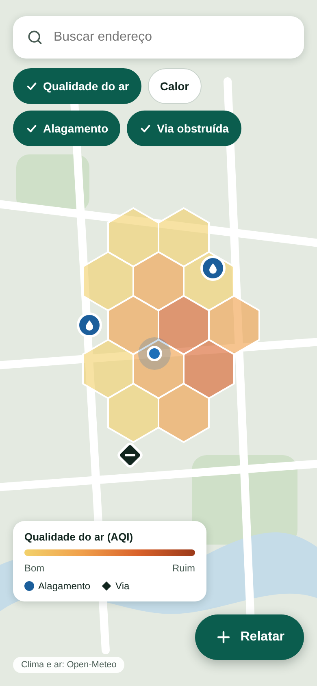

**Requisitos: RF01 a RF04, RNF04, RNF05, UC01**

- O mapa abre na posição do GPS ou, sem GPS, em Ribeirão Preto (tela 2).
- Qualidade do ar e Calor: células hexagonais H3 com dados da Open-Meteo.
- Alagamento e Via obstruída: pontos criados só pelos relatos dos usuários.
- Os 4 botões ligam e desligam cada camada de forma independente.
- Tocar numa célula abre a tela 5; tocar num ponto abre a tela 6.
- A busca ao servidor usa só a região visível (retângulo + células H3), com limite de células.
- Manter a atribuição "Open-Meteo" visível.

## Tela 2 — Mapa sem GPS

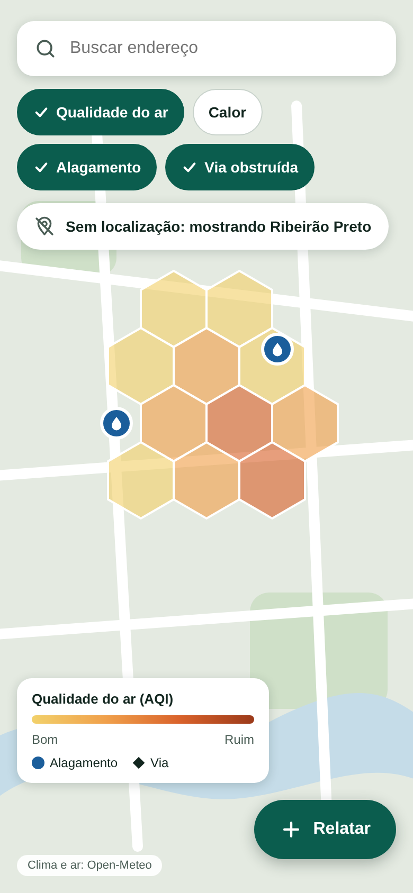

**Requisitos: RF01, UC01**

- Sem GPS (permissão negada ou sinal indisponível), o mapa abre em Ribeirão Preto e avisa o usuário.
- Não há ponto azul de posição; o mapa continua navegável e a busca de endereço funciona.

## Tela 3 — Calor e célula sem dado

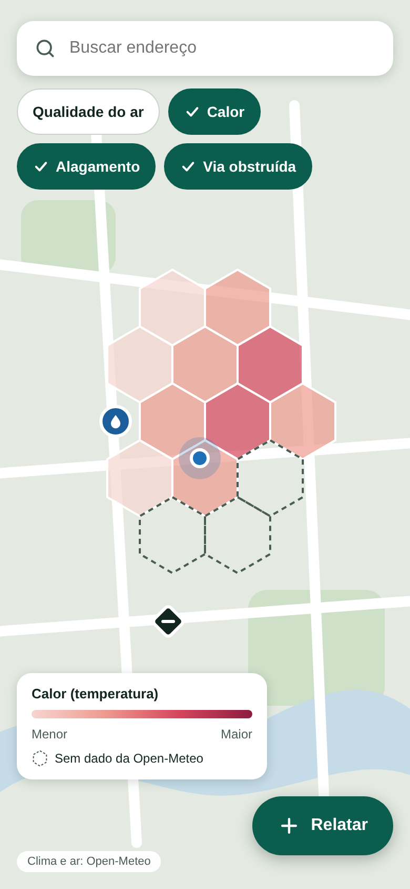

**Requisitos: RF02, RNF03, RNF05**

- Mesma tela com a camada Calor ligada.
- Célula sem dado da Open-Meteo fica sem cor (contorno tracejado). Nunca inventar valores.
- A leitura de clima e ar fica em cache por 10 minutos.

## Tela 4 — Atualizando camada

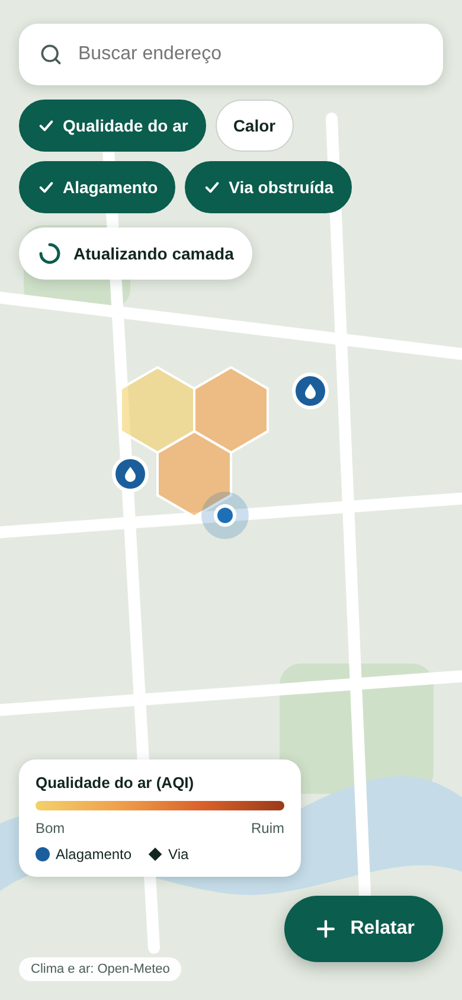

**Requisitos: UC01 (fluxo alternativo)**

- Se o clima ainda não chegou, o mapa continua navegável e mostra "Atualizando camada".
- As células aparecem conforme os dados chegam; os pontos de incidente já podem estar visíveis.

## Tela 5 — Ficha da célula

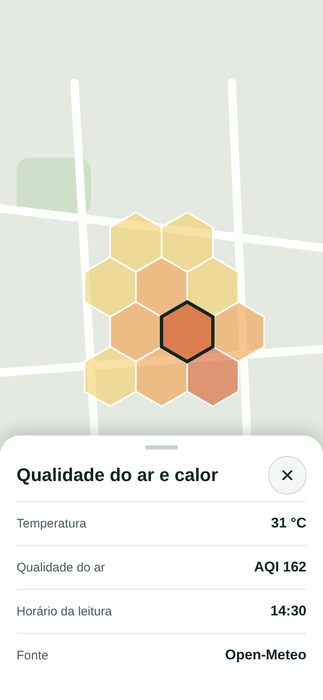

**Requisitos: RF04, UC02**

- Ao tocar numa célula: temperatura, qualidade do ar (AQI), horário da leitura e fonte dos dados.
- O botão X fecha a ficha e volta ao mapa.

## Tela 6 — Ficha do incidente

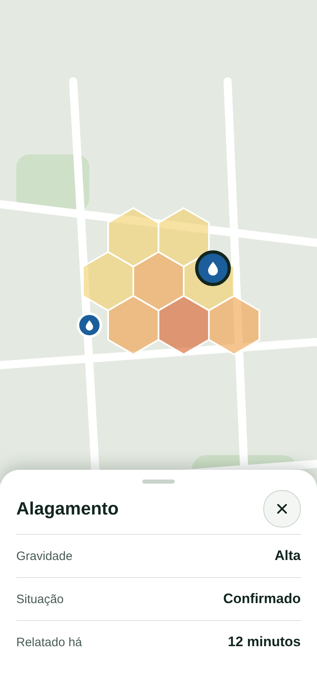

**Requisitos: RF04, RF07, UC02**

- Ao tocar num ponto: tipo, gravidade, situação (recebido ou confirmado) e há quanto tempo foi relatado. Situação "Recebido": tela 13.
- Confirmado = dois relatos do mesmo tipo na mesma célula H3 em até 2 horas.
- O incidente sai do mapa 6 horas depois do último relato.

## Tela 7 — Novo relato

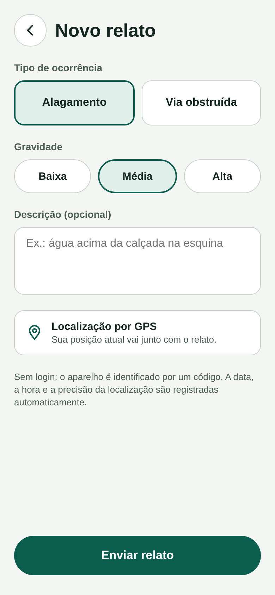

**Requisitos: RF05, RNF01, UC03**

- Só dois tipos: Alagamento e Via obstruída. Gravidade: baixa, média ou alta. Texto opcional.
- Localização preenchida pelo GPS; data, hora e precisão da localização são gravadas automaticamente.
- Sem login: o aparelho é identificado por um código gerado nele.
- Ao enviar, a API coloca o relato na fila e responde na hora, sem esperar o processamento.

## Tela 8 — Relato recusado

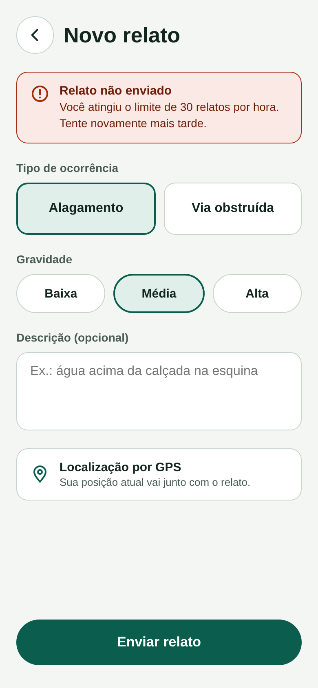

**Requisitos: RF06, UC03 (fluxo alternativo)**

- Relato inválido (tipo, gravidade ou coordenadas) ou acima de 30 por aparelho na última hora é recusado com mensagem.
- Os relatos inválidos vão para a fila de mensagens mortas.
- Os dados digitados são mantidos na tela.

## Tela 9 — Relato enviado

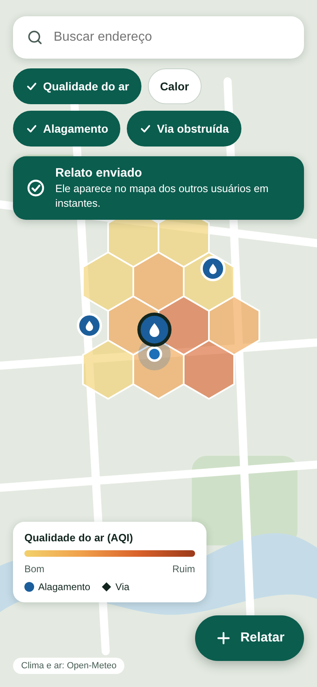

**Requisitos: RF05, RF09, UC03**

- A API responde de imediato e o aplicativo confirma o envio.
- O ponto novo aparece no mapa deste usuário e, por WebSocket, nos mapas dos demais clientes que estiverem vendo a região, sem atualizar a tela.
- O alerta só é gerado quando o incidente é confirmado (dois relatos).

## Tela 10 — Alerta de incidente

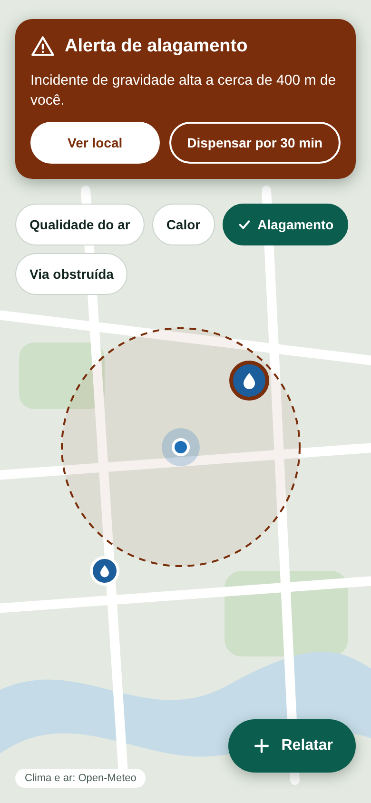

**Requisitos: RF08, RF09, RNF08, RNF09, UC05**

- A faixa aparece quando o usuário está a até 500 m de um incidente ativo de gravidade média ou alta.
- O alerta chega por WebSocket em até 5 segundos depois de o relato ser gravado.
- "Dispensar" silencia o aviso por 30 minutos.
- O alerta é gravado no banco antes de ser publicado; ao reconectar, o cliente recebe os alertas recentes da região.
- Com o aplicativo fechado não há alerta (notificação push fica para versão futura).

## Tela 11 — Alerta de qualidade do ar

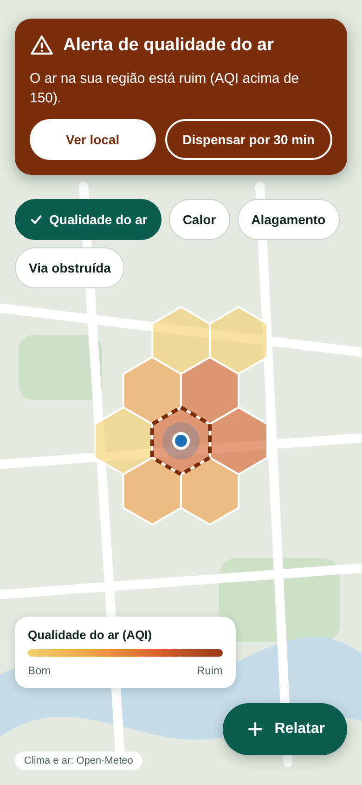

**Requisitos: RF08, RF09, UC05**

- Mesma faixa de alerta, disparada quando o usuário está numa célula com AQI acima de 150.
- Para temperatura acima de 35 °C, ver a tela 14.
- Esse alerta vem dos dados da Open-Meteo, sem depender de relato.

## Tela 12 — Sem conexão

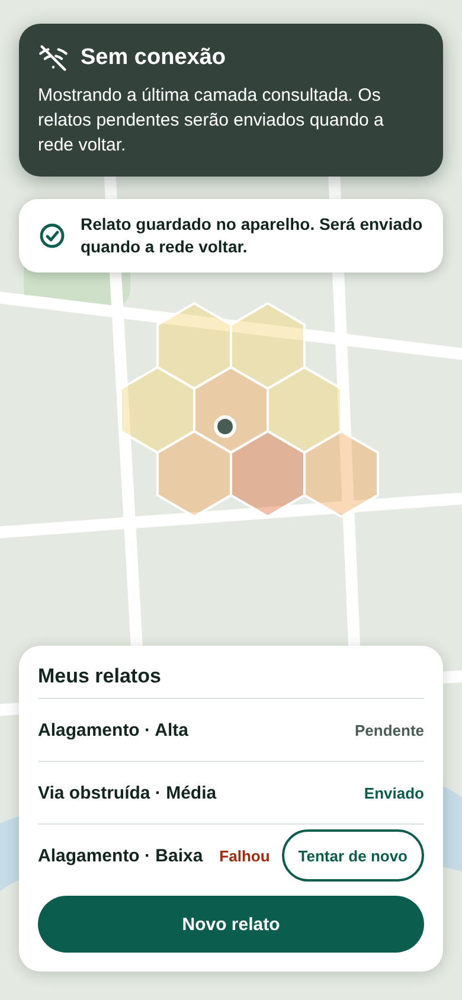

**Requisitos: RF10, UC04**

- Sem rede, o relato fica guardado no aparelho como Pendente, o usuário é avisado e o envio acontece em ordem quando a conexão volta.
- A lista mostra Pendente, Enviado ou Falhou; os que falharam podem ser reenviados.
- O aplicativo mantém a última camada consultada para visualização sem rede.

## Tela 13 — Ficha do incidente recebido

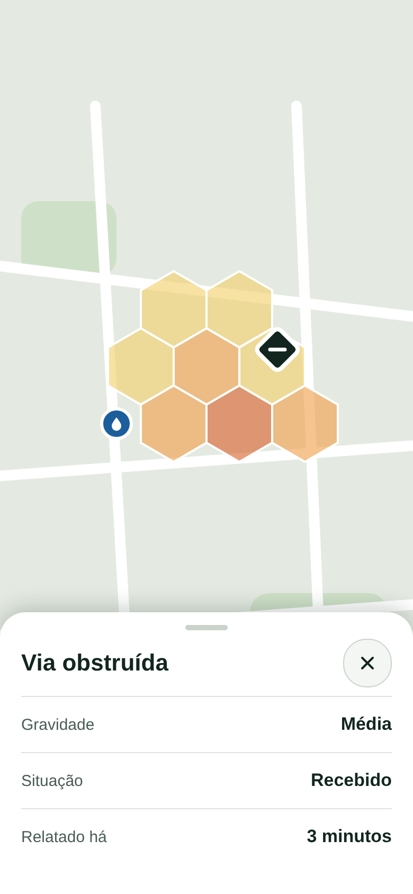

**Requisitos: RF04, RF07, UC02**

- Incidente com apenas um relato: situação "Recebido" (ainda não confirmado).
- Vira "Confirmado" quando há dois relatos do mesmo tipo na mesma célula H3 em até 2 horas (tela 6).
- Pontos de Via obstruída usam o losango; Alagamento usa a gota.

## Tela 14 — Alerta de calor

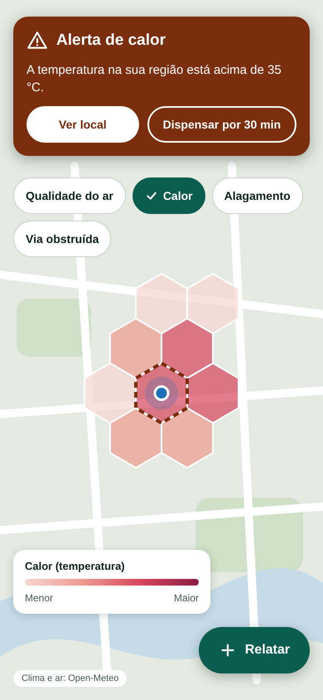

**Requisitos: RF08, RF09, UC05**

- Mesma faixa de alerta, disparada quando o usuário está numa célula com temperatura acima de 35 °C.
- Vem dos dados da Open-Meteo, sem depender de relato.
